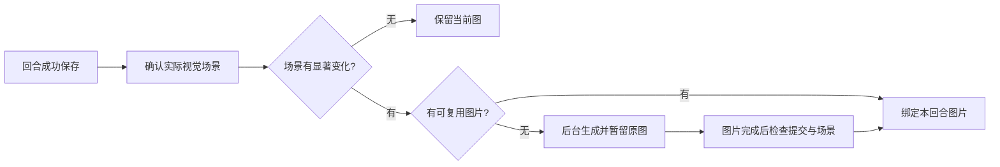

# 按实际场景切换背景图

状态：2026年10月26日的实现方案。当前已完成《绍宋》封面接入；下述场景识别、自动配图及背景切换尚未接入游玩页。

## 可复用的基础

- 存档已有`player.current_location`、`world.time`与`world.weather`，回合通过分支提交保存。玩家端已有已保存状态、历史回合和恢复流程。
- `platform_app/image_jobs.py`已有图片任务入队、异步生成、存储和`image_ready`通知，可关联存档及消息位置。
- 当前玩家页没有场景背景选择与呈现逻辑，现有图片通知也不等于完成了背景绑定。需要增加场景描述、素材匹配、提交关联和显示层。

这是中等范围的增量功能，可复用剧情引擎与生图队列。主要工作是判断何时切图、控制一致性与处理分支，不能只在正文里搜索地名。

## 识别依据

从已成功保存的回合与前后状态提取玩家实际所在的视觉场景，包括：地点、室内外、场景用途、昼夜、天气和已发生的重大环境变化。可复用本轮场景理解与史官结果，输出结构化描述；关键字段未知时保持原图，不从未来原著补齐。

建议使用“剧本＋规范地点＋场景类别＋昼夜档＋显著天气／环境变化＋美术版本”匹配素材。章节号和精确钟刻不作为切换依据。同一军营只过去一刻钟不必换图；变为夜间守营、雪中军议或战后残营时，可以使用另一张图。

| 叙事情况 | 背景行为 |
| --- | --- |
| 玩家已从明道宫后殿走到宫外营地 | 确认地点变化，匹配营地图 |
| 仍在明道宫，白日朝议结束后转入夜间守值 | 匹配同地夜景和相应场景类别 |
| 人物谈到尧山，或计划明日赴尧山 | 保持当前场景，不因提及或计划切图 |
| 通过助手询问远方战况或原著未来 | 咨询不改变场景，不触发生图 |
| 玩家改变原著、战场未形成 | 按本存档环境匹配，不按章节显示既定战场 |
| 回看旧回合、切换分支或回溯 | 显示该提交所关联的图片 |

## 从保存到切图

图片绑定必须包含存档、分支提交和场景标识。生图完成时再次检查这些信息：玩家已经离开该场景、回溯或切换存档时，只缓存结果，不把迟到图片覆盖到当前画面。失败、取消或资料不确定时保留现图，阅读与下一次行动不等待生成。

回看历史时读取该回合图片，不能套用最新背景。缓存先限制在同剧本和有权限的素材范围内；角色私密场景不应因地点同名被其他存档复用。

## 最小落地范围

建议先以《绍宋》的后殿、朝议、军营、城头、行军与战场几类环境验证：为主要地点准备少量风格统一的日夜图，按实际场景匹配切换。运行稳定后再启用缺图自动生成，设定频率与生图预算。图片以环境为主，减少人物外貌和服饰在各图中漂移。

玩家服务还需要配置可用的图片模型及服务凭据，并明确生图的预算与用量记录。现有玩家文本模型配置不能直接视为图片服务；制作这次封面的外部工具也不会自动成为平台后台生图服务。

背景先用于正文外沿及场景展示区域，正文保留足够遮罩和对比度，支持关闭与减少动态效果。初版只要求返回缓存、正确切换与历史一致，不需要自动生成视频或每回合一张图。
